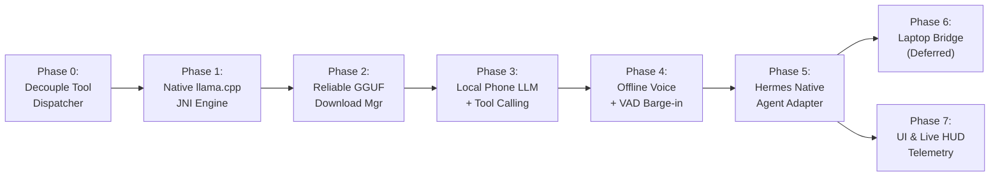

# JARVIS HYBRID AI — IMPLEMENTATION ROADMAP (PHONE-FIRST)

**Document Version:** 1.0.0  
**Date:** October 18, 2026  
**Execution Strategy:** Strict Phone-First Sequencing; Workstation/Laptop Deferred  
**Target Repository:** `C:\Users\Roshan\Documents\Jarvis`  

---

## 1. Roadmap Overview & Phasing Principles

To ensure zero downtime for existing voice capabilities (Gemini Live, Wake-word, Mode A / Mode B HUDs), the implementation is structured into small, verifiable phases. 

**Core Rules:**
- **No breaking changes:** Gemini Live WebSocket must remain fully functional throughout every phase.
- **Phone-First:** Phases 0 through 5 run strictly on the Android device. Phase 6 (Laptop Workstation Bridge) is deferred until on-device capabilities are 100% verified.
- **Continuous Compilation:** The app must compile and build cleanly at the conclusion of every phase.

---

## 2. Phased Milestones Breakdown

---

### Phase 0: Decouple Tool Dispatcher & Establish Clean Abstraction
* **Goal:** Extract all 30+ tools from `JarvisConversationService.kt` into a standalone, reusable `JarvisToolDispatcher.kt` without changing any tool behavior.
* **Exact Files to Create / Modify:**
  - `NEW` `app/src/main/java/com/jarvis/assistant/automation/dispatcher/JarvisToolDispatcher.kt`
  - `NEW` `app/src/main/java/com/jarvis/assistant/ai/provider/AiProvider.kt`
  - `MODIFY` `app/src/main/java/com/jarvis/assistant/background/JarvisConversationService.kt` (delegate `handleToolCallExecution` to `JarvisToolDispatcher`)
* **Acceptance Criteria:**
  - Gemini Live WebSocket executes `open_app`, `set_flashlight`, `call_contact`, and `type_text` via `JarvisToolDispatcher`.
  - Zero regression in online tool calling.

---

### Phase 1: Native Inference Core (`llama.cpp` JNI for arm64-v8a)
* **Goal:** Embed precompiled, high-performance `libllama.so` and JNI bindings into Jarvis.
* **Exact Files to Create / Modify:**
  - `NEW` `app/src/main/jniLibs/arm64-v8a/libllama.so`
  - `NEW` `app/src/main/java/com/jarvis/assistant/ai/local/LlamaNative.kt` (JNI wrapper methods: `loadModel`, `createContext`, `evalToken`, `generateNextToken`, `freeContext`)
  - `MODIFY` `app/build.gradle.kts` (ensure `jniLibs` directory is packaged in the debug APK)
* **Acceptance Criteria:**
  - JNI loads successfully on `iQOO Z7 Pro 5G` (`System.loadLibrary("llama")` succeeds).
  - Calling a native version check returns the `llama.cpp` commit hash.

---

### Phase 2: Reliable GGUF Model Downloader & Storage Manager
* **Goal:** Replace broken/gated HuggingFace URLs with verified, direct, public GGUF model links and implement resumable downloading.
* **Exact Files to Create / Modify:**
  - `MODIFY` `app/src/main/java/com/jarvis/assistant/ai/local/LocalAiConfig.kt` (Add Qwen 2.5 1.5B Instruct and Hermes-2-Pro-Qwen-1.5B GGUF Q4_K_M direct links)
  - `MODIFY` `app/src/main/java/com/jarvis/assistant/ai/local/LocalModelManager.kt` (Implement chunked download with HTTP Range header, SHA256 checksum verification, and `downloadProgress` Flow)
* **Acceptance Criteria:**
  - Downloading `qwen2.5-1.5b-instruct-q4_k_m.gguf` (~986MB) completes successfully with progress reports.
  - `isModelReady()` returns `true` and validates file size and checksum.

---

### Phase 3: Local Phone LLM & Tool Calling Execution
* **Goal:** Implement the real `LocalPhoneProvider` connecting `llama.cpp` native context with token streaming and ChatML tool parsing.
* **Exact Files to Create / Modify:**
  - `NEW` `app/src/main/java/com/jarvis/assistant/ai/provider/LocalPhoneProvider.kt`
  - `MODIFY` `app/src/main/java/com/jarvis/assistant/ai/local/LocalAiEngine.kt` (Remove fake string `when` block; invoke `LocalPhoneProvider`)
  - `NEW` `app/src/main/java/com/jarvis/assistant/ai/local/ToolCallParser.kt` (Parse `<tool_call>{"name": ..., "arguments": ...}</tool_call>`)
* **Acceptance Criteria:**
  - When asked offline: *"What is Newton's third law?"*, the model generates 20+ tokens/sec of accurate explanation.
  - When asked offline: *"Turn on the flashlight"*, the model outputs `<tool_call>`, which automatically triggers `JarvisToolDispatcher` and turns on the flashlight.

---

### Phase 4: Full Offline Voice Loop & VAD Barge-in
* **Goal:** Connect offline speech recognition (Vosk / Android SpeechRecognizer), token streaming, sentence-boundary TTS, and barge-in interruption.
* **Exact Files to Create / Modify:**
  - `MODIFY` `app/src/main/java/com/jarvis/assistant/ai/local/OfflineVoiceConversationEngine.kt` (Route through `LocalPhoneProvider` with sentence-boundary TTS)
  - `MODIFY` `app/src/main/java/com/jarvis/assistant/ai/router/AiFallbackController.kt` (Implement instant auto-failover from Gemini Live to Local Phone LLM upon network loss)
* **Acceptance Criteria:**
  - Turning on Airplane Mode causes Jarvis to speak: *"Network offline; local neural core engaged."*
  - Offline voice dialogue proceeds smoothly without touching the screen.
  - Speaking while Jarvis is answering triggers VAD barge-in, immediately stopping speech and halting inference.

---

### Phase 5: Hermes Native Agent Adapter
* **Goal:** Enable multi-step agent reasoning on the phone using the Nous Hermes agent schema.
* **Exact Files to Create / Modify:**
  - `NEW` `app/src/main/java/com/jarvis/assistant/ai/provider/HermesAgentProvider.kt`
  - Multi-step loop: User Goal -> Hermes Prompt -> Tool Call -> Dispatcher Execution -> Tool Response Injected -> Final Answer.
* **Acceptance Criteria:**
  - Complex instruction offline: *"Check battery level and if it is above 50%, turn on flashlight and open YouTube."*
  - Hermes executes Step 1 (`get_telemetry`), inspects battery, executes Step 2 (`set_flashlight`), executes Step 3 (`open_app("youtube")`), and replies: *"Sir, battery is 78%, flashlight is on, and YouTube is opened."*

---

### Phase 6: Laptop Workstation Bridge (Deferred)
* **Goal:** Connect Jarvis to a high-power PC/workstation running Ollama or llama-server over local Wi-Fi.
* **Status:** **Deferred** until Phases 0–5 are fully tested on the phone.

---

### Phase 7: UI & Live HUD Telemetry Integration
* **Goal:** Surface live AI engine status in Mode A (Stark HUD) and Mode B (Myra HUD).
* **Exact Files to Create / Modify:**
  - `MODIFY` `app/src/main/java/com/jarvis/assistant/ui/home/HomeFragment.kt`
  - `MODIFY` `app/src/main/java/com/jarvis/assistant/ui/myra/MyraHomeFragment.kt`
  - Add status pill displaying active engine ("Gemini Live", "Local Qwen 23 tok/s", "Hermes Agent") and battery/RAM stats.
