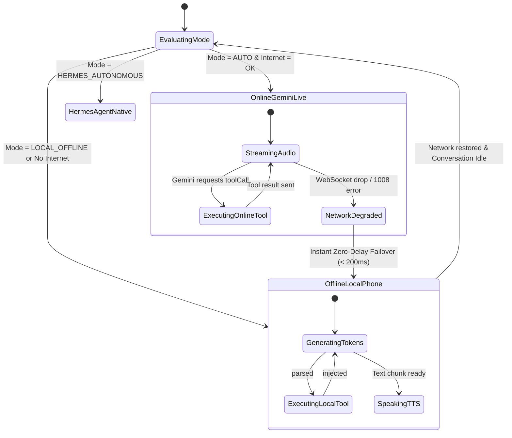

# JARVIS HYBRID AI — RISKS & TEST PLAN

**Document Version:** 1.0.0  
**Date:** October 18, 2026  
**Author:** Lead QA Architect & Android Systems Engineer  
**Target Hardware:** iQOO Z7 Pro 5G (`10BG1D01DA007QG` / vivo I2221)  
**Target Repository:** `C:\Users\Roshan\Documents\Jarvis`  

---

## 1. Critical Risks & Mitigation Matrix

Running local LLM inference alongside real-time voice streaming and autonomous tool execution on Android introduces specific architectural and operating system challenges. The matrix below outlines each risk and its proactive mitigation.

| # | Risk Description | Failure Impact | Mitigation Strategy |
| :--- | :--- | :--- | :--- |
| **1** | **Out of Memory (OOM) / Low Memory Killer (LMK)** | Android OS kills Jarvis background service | 1. Utilize `llama.cpp` `mmap` support to map GGUF weights into kernel virtual pages instead of allocating in the ART/Dalvik heap. 2. Clamp context length strictly to 2048 tokens. 3. Enable `android:largeHeap="true"` in `AndroidManifest.xml`. 4. Monitor `onTrimMemory()` and unload the local model if memory reaches `TRIM_MEMORY_RUNNING_CRITICAL`. |
| **2** | **Duplicate Non-Idempotent Tool Execution** | Actions like sending WhatsApp, calling, or writing memory execute twice during cloud failover | 1. Assign unique monotonic `turnId` and `actionHash` in `JarvisToolDispatcher`. 2. Implement an idempotency cache: if an action with the same signature completed within the current turn, replay the cached result to the fallback engine instead of executing again. |
| **3** | **AudioRecord Resource Contention** | App crashes with `E/AudioRecord: start() status -38` when switching between online and offline | 1. Implement strict sequential state transitions in `JarvisConversationService`. 2. Never initialize Vosk or `AndroidNativeSpeechRecognizer` while Gemini Live WebSocket audio pump is actively holding `AudioRecord`. 3. Wait for `AudioRecord.stop()` and `release()` before activating the alternate recognizer. |
| **4** | **Infinite Agentic Loops in Hermes Mode** | Hermes model keeps calling tools in an endless cycle, draining battery | 1. Enforce hard cap: `MAX_AGENT_STEPS = 5`. 2. Implement step signature hashing: if the exact same `(function_name, arguments)` is generated twice consecutively with a failure result, immediately abort the loop and explain the issue to the user. |
| **5** | **Native JNI Crash (SIGSEGV / Signal 11)** | Entire process crashes without Kotlin stack trace if GGUF is corrupted | 1. Perform strict pre-flight validation on downloaded models: check GGUF magic bytes (`0x46 0x55 0x47 0x47` = `GGUF`) at offset 0. 2. Validate SHA256 checksum against known manifest before calling native `llama_load_model_from_file()`. 3. Wrap all JNI calls in a guarded C++ `try/catch` and return an error code instead of throwing native signals. |
| **6** | **Battery Drain from Background Inference** | Uncontrolled background threads consume high CPU power | 1. Limit `llama.cpp` thread count to 4 threads (utilizing 2x Cortex-A715 cores + 2x Cortex-A510 cores). 2. Automatically pause inference and release wake locks if the screen is off and no voice conversation turn is active for >60 seconds. |

---

## 2. Fallback State Machine Specification

The `AiFallbackController` implements a deterministic state machine to govern transitions between Gemini Live, Local Phone LLM, and the Laptop Bridge:

---

## 3. Comprehensive Verification & Test Plan

### Test Suite A: Unit Tests (Host JVM)

| Test Class | Test Target | Verification Check |
| :--- | :--- | :--- |
| `JarvisToolDispatcherTest` | `JarvisToolDispatcher.kt` | Validates that dispatching `set_flashlight`, `open_app`, `type_text`, `scroll_screen`, `set_volume` returns structured `AiToolResult` with correct success flags. |
| `ToolCallParserTest` | `ToolCallParser.kt` | Tests regex extraction of `<tool_call>` blocks from raw token streams, including handling broken XML and nested JSON. |
| `HermesPromptBuilderTest` | `HermesAgentProvider.kt` | Verifies ChatML formatting with `<tools>` array, system instructions, and user prompt structure. |
| `AiFallbackControllerTest` | `AiFallbackController.kt` | Simulates network drops and confirms that state transitions from `OnlineGeminiLive` to `OfflineLocalPhone` in under 200ms without throwing exceptions. |

---

### Test Suite B: Instrumented & On-Device Integration Tests (`iQOO Z7 Pro 5G`)

| ID | Test Scenario | Execution Steps | Expected Outcome | Pass/Fail Criteria |
| :--- | :--- | :--- | :--- | :--- |
| **TC-01** | **JNI Engine Load & Pre-warm** | Cold start app; initialize `llama.cpp` JNI. | `libllama.so` loads into process memory without error. | `LlamaNative.isLoaded()` returns `true`; memory increase < 50MB before model load. |
| **TC-02** | **GGUF Model Verification** | Verify downloaded `qwen2.5-1.5b-instruct-q4_k_m.gguf`. | File header magic bytes match `GGUF`; file size matches manifest. | `LocalModelManager.isModelReady()` returns `true`. |
| **TC-03** | **Offline Conversational Latency** | Disconnect Wi-Fi and Cellular. Speak: *"What is gravitational acceleration?"* | Vosk transcribes audio; `LocalPhoneProvider` streams response. | First token latency < 1.2s; generation rate > 18 tokens/sec. |
| **TC-04** | **Offline Tool Execution** | Disconnect Wi-Fi. Speak: *"Turn on the flashlight."* | Model emits `<tool_call>`; `JarvisToolDispatcher` triggers hardware torch. | Torch LED turns on within 1.5 seconds of speaking; assistant speaks confirmation. |
| **TC-05** | **Zero-Downtime Failover** | Start Gemini Live session. During conversation, toggle Airplane Mode. | Service detects network drop and immediately transfers conversation to `LocalPhoneProvider`. | No audio crash; Jarvis speaks: *"Sir, network dropped. Switching to local offline core."* |
| **TC-06** | **VAD Barge-in Interruption** | Ask a long offline query. While Jarvis is speaking, say: *"Stop"* or *"Jarvis"*. | Energy VAD detects voice; immediately halts TTS audio playback and cancels local token generation. | Audio stops within 250ms of user utterance. |
| **TC-07** | **Multi-Step Hermes Tool Calling** | Ask offline: *"Check battery and open YouTube."* | Hermes generates step 1, receives battery info, generates step 2 (`open_app`), and concludes. | YouTube launches; assistant speaks battery status and confirmation. |

---

## 4. Acceptance Sign-off Criteria

The Hybrid AI integration will be deemed **complete and production-ready** when:
1. `assembleDebug` builds cleanly with zero compilation or lint errors.
2. The debug APK installs and runs on the connected `iQOO Z7 Pro 5G` without crashes.
3. Both Mode A (Stark HUD) and Mode B (Myra HUD) display live AI engine telemetry.
4. Voice interaction works seamlessly in 100% offline conditions (Airplane mode) with conversational responses and tool execution.
5. Online Gemini Live continues operating with full bidirectional voice and tools when network is restored.
