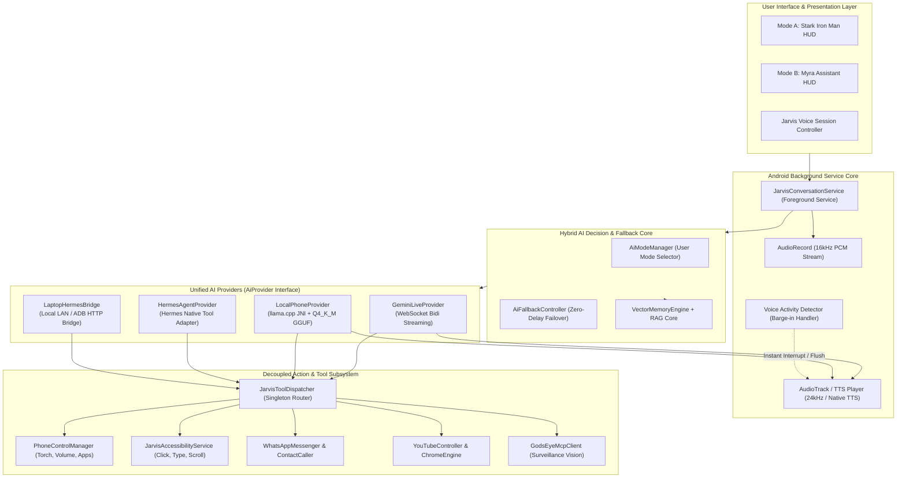
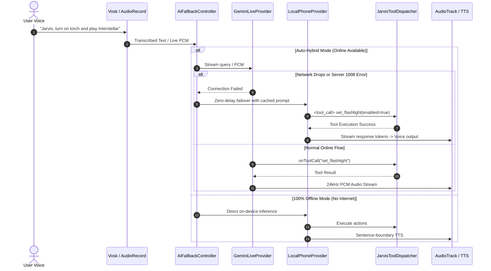

# JARVIS HYBRID AI — TARGET ARCHITECTURE SPECIFICATION

**Document Version:** 1.0.0  
**Date:** October 18, 2026  
**Architect:** Senior Android AI Architect & Systems Engineer  
**Target Repository:** `C:\Users\Roshan\Documents\Jarvis`  

---

## 1. Executive Architecture Overview

The target architecture establishes **ONE unified, cohesive Jarvis AI application** that seamlessly fuses three distinct AI engines into a modular, high-reliability system:

1. **Gemini Live AI (Online):** Real-time bidirectional streaming over WebSocket with ultra-low latency audio, vision input, and Google Cloud-scale reasoning.
2. **Local Phone LLM (100% Offline):** On-device small language model inference powered by a high-performance native `llama.cpp` C++ engine (`libllama.so` for arm64-v8a) executing quantized GGUF weights locally with zero internet dependency.
3. **Hermes Agent (Autonomous Tool Calling & Multi-Step Reasoning):** Autonomous agent capabilities utilizing the Nous Research Hermes function calling schema and prompt formatting, running directly on the phone via a native Kotlin adapter and optionally bridging to a full workstation runtime when connected to a laptop.

All three engines share a **single, unified Tool Dispatcher (`JarvisToolDispatcher`)**, ensuring that every capability (flashlight, apps, WhatsApp, accessibility clicks, YouTube, camera, phone calls, reminders, memory vault) works identically regardless of which AI model generated the instruction.

---

## 2. High-Level Architecture Diagram



---

## 3. The Clean Interface Abstraction

To eliminate hardcoded couplings, all AI engines implement the standard `AiProvider` interface:

```kotlin
package com.jarvis.assistant.ai.provider

import kotlinx.coroutines.flow.Flow
import org.json.JSONObject

enum class AiProviderType {
    GEMINI_LIVE_ONLINE,
    LOCAL_PHONE_OFFLINE,
    HERMES_AGENT_NATIVE,
    LAPTOP_HERMES_BRIDGE
}

sealed class ProviderHealthState {
    object Healthy : ProviderHealthState()
    data class Degraded(val reason: String) : ProviderHealthState()
    data class Unavailable(val error: String) : ProviderHealthState()
}

data class AiStreamChunk(
    val token: String,
    val isComplete: Boolean = false,
    val toolCallDetected: AiToolCall? = null
)

data class AiToolCall(
    val callId: String,
    val functionName: String,
    val arguments: JSONObject
)

data class AiToolResult(
    val callId: String,
    val functionName: String,
    val isSuccess: Boolean,
    val resultJson: JSONObject,
    val errorMessage: String? = null
)

interface AiProvider {
    val providerType: AiProviderType
    
    suspend fun initialize(): Boolean
    fun isReady(): Boolean
    fun checkHealth(): ProviderHealthState
    
    fun streamResponse(
        prompt: String,
        systemPrompt: String,
        memoryContext: String,
        chatHistory: List<com.jarvis.assistant.data.model.ChatTurn>,
        availableTools: List<JSONObject>
    ): Flow<AiStreamChunk>
    
    suspend fun executeToolCall(toolCall: AiToolCall): AiToolResult
    suspend fun unload()
}
```

---

## 4. The Unified Tool Dispatcher: Decoupling Actions

Currently, tool execution is locked inside `JarvisConversationService.kt` (`handleToolCallExecution`). In the target architecture, this logic is decoupled into a dedicated, reusable component:

```kotlin
package com.jarvis.assistant.automation.dispatcher

import android.content.Context
import org.json.JSONObject
import kotlinx.coroutines.sync.Mutex
import kotlinx.coroutines.sync.withLock

class JarvisToolDispatcher private constructor(private val context: Context) {
    companion object {
        @Volatile
        private var instance: JarvisToolDispatcher? = null

        fun getInstance(context: Context): JarvisToolDispatcher {
            return instance ?: synchronized(this) {
                instance ?: JarvisToolDispatcher(context.applicationContext).also { instance = it }
            }
        }
    }

    private val executionMutex = Mutex()

    /**
     * Executes any registered tool call safely across threads.
     * Can be invoked by:
     *  - Gemini Live WebSocket listener
     *  - Local llama.cpp XML/JSON parser
     *  - Hermes Agent Native parser
     *  - Laptop HTTP Bridge
     */
    suspend fun dispatchTool(
        callId: String,
        functionName: String,
        arguments: JSONObject
    ): AiToolResult = executionMutex.withLock {
        // Shared execution routing:
        // open_app, set_flashlight, set_volume, send_whatsapp_message,
        // click_ui_element, type_text, scroll_screen, search_youtube, etc.
        ...
    }
}
```

### Tool Definition Registry
Tools are declared once in JSON Schema format compliant with both **Google Gemini function declarations** and **Hermes / OpenAI tool schemas**. 

```json
{
  "name": "set_flashlight",
  "description": "Turns the phone flashlight / torch on or off.",
  "parameters": {
    "type": "object",
    "properties": {
      "enabled": {
        "type": "boolean",
        "description": "True to turn on flashlight, False to turn off."
      }
    },
    "required": ["enabled"]
  }
}
```

---

## 5. Hermes Agent: Architecture & Real-World Feasibility

### Clarifying Hermes Agent Runtime vs. Hermes Model
There is a fundamental difference between the **Hermes Agent Runtime** and **Hermes LLM Weights**:

| Attribute | Hermes Agent Runtime | Hermes Model Weights |
| :--- | :--- | :--- |
| **What it is** | Python/Node execution engine for autonomous workflows, memory state, and multi-step tasks. | The quantized transformer neural network (e.g., `Hermes-2-Pro-Qwen-1.5B`, `Nous-Hermes-3-Llama-3.1-8B`). |
| **Role** | Evaluates goal, loops through tool calls, tracks scratchpad state, handles agentic retries. | Predicts tokens and generates `<tool_call>` XML/JSON tokens. |
| **Android Feasibility** | **Heavy/Impedance Mismatch:** Requires Python runtime, Termux subprocesses, significant battery drain. | **100% Feasible:** Can run directly on-device via `llama.cpp` JNI (`Hermes-2-Pro-Qwen-1.5B.Q4_K_M.gguf`). |

### The Target Hybrid Strategy for Hermes

1. **On Android Phone (Native Phone-First Architecture):**
   - We do **not** run an expensive Python interpreter or Termux daemon in the background.
   - Instead, we implement a **Native Kotlin Hermes Engine (`HermesAgentProvider.kt`)**.
   - It formats prompts using the official Nous Hermes prompt template:
     ```
     <|im_start|>system
     You are a helpful assistant with access to the following tools:
     <tools>
     [{"type": "function", "function": {...}}]
     </tools>
     <|im_end|>
     <|im_start|>user
     Turn on the flashlight and open YouTube.
     <|im_end|>
     <|im_start|>assistant
     <tool_call>
     {"name": "set_flashlight", "arguments": {"enabled": true}}
     </tool_call>
     ```
   - When the on-device model (`llama.cpp`) generates the `<tool_call>` block, the Kotlin adapter intercepts it, dispatches it to `JarvisToolDispatcher`, inserts the `<tool_response>`, and continues generation until completion.
   - This provides **100% native Hermes-style agentic tool calling on the phone with zero Python overhead**.

2. **On Windows Laptop (Workstation Bridge):**
   - The user runs the full Python-based Hermes Agent runtime or an Ollama/llama-server instance on their PC.
   - When the phone and laptop are on the same local Wi-Fi network (or connected via USB ADB port-forwarding), Jarvis can route heavy coding, repo indexing, or deep reasoning tasks to the laptop via `LaptopHermesBridge.kt`.

---

## 6. Hybrid Fallback Controller & Zero-Delay State Machine

The `AiFallbackController` guarantees that user commands are never dropped:



### Fallback Rules:
1. **Network Disconnection:** Instant fallback to `LocalPhoneProvider` within 200ms.
2. **Online Quota or Key Error:** Immediately marks `GeminiLiveProvider` as degraded; subsequent queries route directly to `LocalPhoneProvider`.
3. **Graceful Restoration:** Periodically probes network health in the background without interrupting ongoing conversations.

---

## 7. Memory & RAG Integration

All three providers receive the exact same enriched context payload from `VectorMemoryEngine`:
- **Academic & Science Vault:** Instant exact-match lookup for physics, mathematics, and science definitions.
- **Persistent User Memory:** SQLite + Vector embedding store containing user facts, preferences, and personal details.
- **Short-Term Turns:** Ring buffer of the last 4 conversation turns to maintain dialogue context without exhausting context memory.

---

## 8. Summary of Target Architectural Gains

1. **Zero Fake Implementations:** Real `llama.cpp` JNI runtime replaces placeholder comments.
2. **Unified Actions:** Device controls, accessibility automation, and messaging work identically across Gemini, Hermes, and Offline LLMs.
3. **Resilient Failover:** User never experiences an abrupt error message; Jarvis gracefully falls back from cloud to local device cores.
4. **Clean Code Separation:** Network protocols, UI HUDs, tool execution, and inference engines are cleanly separated into decoupled, testable components.
