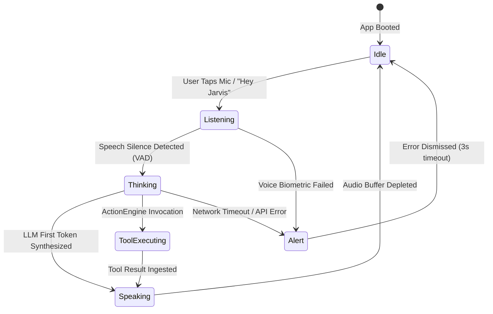

# JARVIS × MYRA AI — MASTER ANIMATION & MOTION SPECIFICATION
**Document ID:** `JARVIS-ANIM-SPEC-004`  
**Classification:** Motion Physics & Interaction Timing Standard  
**Package:** `com.jarvis.assistant.util` (`HudAnimationHelper.kt`)  

---

## 1. Motion Philosophy: Cybernetic Precision & Fluidity

The Jarvis motion language is engineered around three core principles:
1. **Immediate Reaction (<16ms, 1 frame at 60fps / 120Hz):** No click, tap, or gesture may feel sluggish. The touch response begins on the exact frame of contact.
2. **Physical Kinetic Weight:** Elements decelerate naturally using physics-based spring curves and cubic-bezier easing (`PathInterpolator(0.2f, 0.0f, 0.0f, 1.0f)`).
3. **Information-Carrying Motion:** Animations never exist purely for decoration; they communicate system throughput, LLM token streaming speed, hardware health, and security integrity.

---

## 2. Core Interactive Energy Orb: WebGL Physics State Machine

The central energy orb (`particle_orb.html` hosted in `OrbHelper.kt`) implements a 6-phase state machine with dynamic particle vectors:



### Detailed Shader & Particle Parameter Specifications

| Parameter | 1. IDLE STATE | 2. LISTENING STATE | 3. THINKING (REASONING) | 4. SPEAKING (SYNTHESIS) | 5. TOOL EXECUTING | 6. ALERT / THREAT |
| :--- | :--- | :--- | :--- | :--- | :--- | :--- |
| **Particle Count** | 450 | 850 | 1200 | 950 | 1400 | 1600 |
| **Particle Base Color** | `#00E5FF` (Cyan) | `#00E676` (Emerald) | `#7C4DFF` (Deep Violet) | Dynamic Accent | `#FFD600` (Solar Amber) | `#FF1744` (Crimson) |
| **Core Halo Bloom** | 24px (Soft) | 48px (Pulsing) | 64px (Swirling Vortex) | Audio-Reactive (20-80px)| 72px (Fast Orbit) | 90px (Strobe Flash) |
| **Rotation Velocity**| `0.004 rad/frame` | `0.012 rad/frame` | `0.035 rad/frame` | `0.018 rad/frame` | `0.045 rad/frame` | `0.060 rad/frame` |
| **Orb Scale Factor** | `1.00x` | `1.08x` (Expanded) | `0.92x` (Dense Core) | `1.00x - 1.15x` (Decibels) | `1.05x` (Vibrating) | `1.20x` (Emergency) |
| **Waveform Amplitude**| Flat / Calm Drift | Reactive Mic Input | Spiral Double Helix | Real-time TTS Frequencies | Sawtooth Wave | High-Frequency Spike|
| **Sound Feedback** | Ambient low hum | Mic open chirp | High-frequency calculation | Voice stream playback | Mechanical relay click | Klaxon warning pulse |

---

## 3. UI Component Motion & Interaction Specs

### 3.1 Card Touch Feedback (Micro-Interaction)
- **Trigger:** Operator touch-down (`ACTION_DOWN`) on any action card (`@drawable/bg_jarvis_action_card`).
- **Transform:**
  - Scale: Depresses from `1.00x` to `0.96x` on both X and Y axes.
  - Elevation: Decreases from `4dp` to `1dp`.
  - Border: Alpha transitions from `0.08` to `0.40` with dynamic theme tint.
- **Timing:** Duration `90ms`.
- **Easing:** `AccelerateInterpolator()`.
- **Release (`ACTION_UP` / `ACTION_CANCEL`):**
  - Spring overshoot recovery to `1.00x` with dampening ratio `0.65` and stiffness `SpringForce.STIFFNESS_MEDIUM`. Duration `180ms`.

### 3.2 Floating Elevated Microphone Button Dynamics
- **Idle Breathing Loop:**
  - Scale oscillates between `1.00x` and `1.04x` over a `2400ms` period.
  - Halo alpha pulses between `0.25` and `0.60`.
  - Interpolator: `AccelerateDecelerateInterpolator()`.
- **Tap Activation (Live Mic Opening):**
  - Immediate `0.88x` compression (`60ms`), followed by explosive expansion to `1.15x` (`140ms`).
  - Expanding concentric rings emit outward from the button center (3 staggered waves with `400ms` lifespan, fading from `0.8` alpha to `0.0`).

### 3.3 Stark Protocols Menu (Bottom Sheet Reveal)
- **Trigger:** Top hamburger icon button (`btnMenu`) pressed.
- **Backdrop Scrim:** Alpha animates from `0.0` to `0.75` with real-time hardware blur expanding to `25f` over `280ms`.
- **Sheet Translation:** Enters from `y = screenHeight` to anchor position using custom spring curve:
  ```kotlin
  val sheetSpring = SpringAnimation(bottomSheetView, DynamicAnimation.TRANSLATION_Y).apply {
      spring.dampingRatio = SpringForce.DAMPING_RATIO_LOW_BOUNCY // 0.75
      spring.stiffness = SpringForce.STIFFNESS_LOW // 300f
  }
  ```
- **Staggered Tile Cascade:** The 10 protocol tiles fade and slide upward in succession, each delayed by `25ms` (`tile_0` at 0ms, `tile_1` at 25ms, `tile_2` at 50ms...).

### 3.4 Conversational Chat Streaming & Bubble Insertion
- **New Turn Insertion:**
  - Container enters with `translationY = +30dp` and `alpha = 0.0f` transitioning to `translationY = 0dp` and `alpha = 1.0f` over `200ms` (`DecelerateInterpolator()`).
- **Streaming Markdown Text Reveal:**
  - Text tokens render continuously at the rate of LLM packet arrival (typically 20-60ms per chunk).
  - Smooth auto-scroll keeps the bottom line pinned to viewport, clamped with `smoothScrollBy()` to prevent jerky frame jumps.

### 3.5 Matrix Digital Rain Animation Loop (`JarvisMatrixActivity`)
- **Render Engine:** Custom surface view `MatrixRainView.kt`.
- **Column Density:** 42 vertical columns across a standard 1080p display.
- **Glyph Set:** Monospace alphanumeric characters, Katakana symbols, and cybernetic hex codes (`0-9`, `A-F`, `0x`, `Ω`, `λ`, `Ψ`).
- **Fall Velocity:** Randomized per column between `12dp/frame` and `28dp/frame`.
- **Decay Trail:** Top leader glyph is pure bright white (`#FFFFFF`), trailing 8 glyphs fade through `#00E5FF` to `rgba(0, 229, 255, 0.05)`.
- **Framerate Target:** Strictly locked to device refresh rate (60Hz / 90Hz / 120Hz) via `Choreographer.postFrameCallback`.

---

## 4. Reduced-Motion & Battery Optimization Adaptations

Accessibility compliance is rigorously respected via `HudAnimationHelper.kt`:

```kotlin
fun shouldReduceMotion(context: Context): Boolean {
    val durationScale = Settings.Global.getFloat(
        context.contentResolver,
        Settings.Global.ANIMATOR_DURATION_SCALE, 1.0f
    )
    val transitionScale = Settings.Global.getFloat(
        context.contentResolver,
        Settings.Global.TRANSITION_ANIMATION_SCALE, 1.0f
    )
    return durationScale == 0f || transitionScale == 0f || isPowerSaveMode(context)
}
```

### Motion Fallback Table
| Animation Target | Full Motion Mode | Reduced Motion / Power Save Mode |
| :--- | :--- | :--- |
| **WebGL Energy Orb** | 1200 live dynamic particles with 3D rotation | 2D static glowing vector ring with subtle opacity cross-fade |
| **Protocols Bottom Sheet** | 300ms spring slide with 25ms staggered tiles | Instant alpha fade (100ms) with all tiles revealed simultaneously |
| **Matrix Digital Rain** | Continuous 120fps canvas rendering | Static high-tech carbon fiber background pattern |
| **Elevated Mic Button** | Continuous sine-wave breathing & concentric waves | Static solid highlight border; no pulsing |
| **Card Tap Feedback** | Scale depression to `0.96x` with spring bounce | Instant ripple drawable highlight; no geometric translation |

---
*Verified against active animation logic in `HudAnimationHelper.kt`.*
