# JARVIS × MYRA AI — MASTER NAVIGATION & INFORMATION ARCHITECTURE TREE
**Document ID:** `JARVIS-NAV-ARCH-002`  
**Classification:** System Information Architecture Specification  
**Version:** 2.0 (Unified Jarvis + Myra Integration)  
**Package:** `com.jarvis.assistant`  

---

## 1. Master Application Hierarchy Diagram

```mermaid
graph TD
    Root["JARVIS AI ASSISTANT ROOT"] --> HomeNav["1. Main Dashboard & Energy HUD"]
    Root --> BottomDock["2. Floating Curved Bottom Dock"]
    Root --> TopMenu["3. Stark Protocols Overlay Menu"]
    Root --> SuperCore["4. SuperCore OS Controller"]
    Root --> JarvisMatrix["5. Jarvis Matrix Autonomous Hub"]
    Root --> SettingsNav["6. Deep Settings & Configuration"]
    Root --> FloatingSentinels["7. Background Floating Sentinels"]

    %% Bottom Dock
    BottomDock --> NavHome["Home/Orb (MainActivity)"]
    BottomDock --> NavChat["Tactical Chat (ChatFragment)"]
    BottomDock --> NavMic["Elevated Mic (Live Stream/VAD)"]
    BottomDock --> NavGodsEye["God's Eye (GodsEyeActivity)"]
    BottomDock --> NavStudio["Stark Studio (CustomizationStudioActivity)"]

    %% Protocols Menu
    TopMenu --> ProtoDiagnostics["Diagnostics Sentinel"]
    TopMenu --> ProtoSuperCore["SuperCore Launcher"]
    TopMenu --> ProtoMatrix["Matrix Launcher"]
    TopMenu --> ProtoGodsEye["God's Eye Satellite"]
    TopMenu --> ProtoMemory["Memory Vault"]
    TopMenu --> ProtoVoice["Voice Biometrics"]
    TopMenu --> ProtoSecurity["Security Shield"]

    %% SuperCore Subsystems
    SuperCore --> SC_Grounding["Screen Grounding & Vision"]
    SuperCore --> SC_Accessibility["Accessibility Automator"]
    SuperCore --> SC_Comms["WhatsApp & Call Sentinel"]
    SuperCore --> SC_Sensors["Hardware Telemetry & Battery"]
    SuperCore --> SC_HandsFree["Hands-Free Driving Sentinel"]

    %% Jarvis Matrix Subsystems
    JarvisMatrix --> JM_Termux["Termux Shell Agent"]
    JarvisMatrix --> JM_N8N["n8n Webhook Automator"]
    JarvisMatrix --> JM_YT["YouTube Content Agent"]
    JarvisMatrix --> JM_GitHub["GitHub Repo Worker"]
    JarvisMatrix --> JM_Marketing["Marketing & Copy Engine"]
    JarvisMatrix --> JM_Social["Social Media Post Scheduler"]

    %% Settings Subsystems
    SettingsNav --> Set_Profile["Operator Profile"]
    SettingsNav --> Set_AI["AI Models (Gemini/Ollama)"]
    SettingsNav --> Set_Voice["Persona & Speech Matrix"]
    SettingsNav --> Set_Overlay["Floating Bubble & Avatars"]
    SettingsNav --> Set_Security["App Lock & Biometrics"]
    SettingsNav --> Set_Backup["Vector Cloud Backup/Restore"]
```

---

## 2. Comprehensive Navigation & Information Architecture Catalog

### Level 1: Primary Root Destinations

#### 1.1 Home Dashboard & Reactive Orb HUD
- **Destination:** `MainActivity.kt` hosting `HomeFragment.kt` (`fragment_home.xml`)
- **Parent Category:** Root / Level 0
- **Purpose:** Primary command viewport. Delivers real-time status telemetry, live interactive WebGL energy core, and quick-launch status pills.
- **Content Displayed:**
  - Dynamic status bar (Operator call-sign, battery % with charging pulse, active AI model badge, connection latency ping).
  - Central 3D/WebGL Reactive Energy Orb (`previewOrbWebView` loading `particle_orb.html`).
  - Ambient halo glow rings reflecting active state (Cyan = Idle, Pulsing Violet = Thinking, Amber = Tool Calling, Red = Alert).
  - Telemetry strip: Real-time weather, ambient temperature, GPS city geofence, and local host server heartbeat.
  - Quick action chips: "Analyze Screen", "Read Unread", "Start Driving Mode", "Termux Status".
- **Available Actions:**
  - Single tap orb: Toggle voice listening (Gemini Live / Whisper).
  - Double tap orb: Launch multimodal screen capture & UI grounding.
  - Long press orb: Instant sleep / standby mode toggle.
  - Tap telemetry card: Expand live weather & system diagnostics sheet.
- **Relationships:** Direct parent of Bottom Dock; triggers `StarkMenuBottomSheet.kt` via top hamburger button; triggers `ChatFragment.kt` via swipe left.
- **Permissions / Dependencies:** `RECORD_AUDIO`, `ACCESS_FINE_LOCATION`, `INTERNET`.
- **Implementation Status:** Fully Implemented and Active.

---

#### 1.2 Tactical Conversational Chat
- **Destination:** `ChatFragment.kt` (`fragment_chat.xml`) inside `MainActivity`
- **Parent Category:** Main Dock / Level 1
- **Purpose:** High-throughput streaming conversational viewport for text, multimodal images, tool results, and execution traces.
- **Content Displayed:**
  - Chronological message history with distinct bubbles for Operator, Jarvis, and Autonomous Agents.
  - Streaming token output rendered via Markdown parser (supporting tables, syntax-highlighted code blocks, LaTeX KaTeX formulas).
  - Embedded tool execution cards (e.g., "Termux: `apt update` executed in 412ms", "WhatsApp message dispatched to John").
  - Audio waveform visualizer when speech response is synthesizing.
  - Bottom input console with attachment launcher (+), prompt generator magic wand, camera quick-snap, and send button.
- **Available Actions:**
  - Tap message to copy or re-speak via TTS.
  - Swipe message to reply or quote in prompt.
  - Tap code block "Copy" button or "Run in Termux" button.
  - Tap tool result card to inspect JSON payload or raw terminal output.
  - Tap "History" button in top toolbar to open `ChatHistoryBottomSheet.kt`.
- **Relationships:** Embedded within `MainActivity` ViewPager2; communicates with `MainViewModel.kt` and `GeminiLiveWebSocket.kt`.
- **Permissions / Dependencies:** `INTERNET`, `READ_MEDIA_IMAGES`.
- **Implementation Status:** Fully Implemented and Active.

---

#### 1.3 Autonomous Live Mic & Gemini Live Streaming
- **Destination:** Elevated Center Button on `CurvedDockLineView` (triggers `MainViewModel.toggleLiveStreaming()`)
- **Parent Category:** Main Dock / Level 1
- **Purpose:** Direct, ultra-low latency (<200ms) full-duplex bidirectional voice conversation with server or device.
- **Content Displayed:**
  - Expanding holographic audio spectrum overlay across bottom dock.
  - Live transcription preview card appearing above dock.
  - Floating cancel (X) and mute mic buttons.
- **Available Actions:**
  - Single tap: Establish persistent WebSocket connection to Gemini Live / Ollama local audio engine.
  - Speak naturally: Real-time barge-in interruption detection (auto-mutes assistant when user speaks).
  - Tap again: Gracefully close live session and persist transcript to Room database.
- **Relationships:** Can be triggered from any screen, overlay avatar, or background wake word ("Hey Jarvis").
- **Permissions / Dependencies:** `RECORD_AUDIO`, `MODIFY_AUDIO_SETTINGS`, `FOREGROUND_SERVICE_MICROPHONE`.
- **Implementation Status:** Fully Implemented and Active.

---

#### 1.4 God's Eye Visual Intelligence & CCTV Telemetry
- **Destination:** `GodsEyeActivity.kt` (`activity_gods_eye.xml`)
- **Parent Category:** Main Dock / Level 1
- **Purpose:** Global surveillance, satellite geospatial telemetry, CCTV camera integration, and real-time visual reasoning.
- **Content Displayed:**
  - Live video feed / map viewport with interactive target crosshairs.
  - Telemetry HUD overlay: Azimuth, Elevation, GPS Coordinates, Satellite Lock Count, Target Distance Vector.
  - Multi-camera grid selector (Front Camera, Back Wide-Angle, USB Thermal/Endoscope, RTSP Security Feeds).
  - Object detection bounding boxes with real-time confidence scores and OCR text extractions.
  - MCP Client connection status badge (`GodsEyeMcpClient.kt`).
- **Available Actions:**
  - Tap "Lock Target" to track objects across camera frames.
  - Tap "Thermal / Night Vision" shader toggle.
  - Tap "Capture & Ingest to Memory" to save image embeddings to vector store.
  - Tap "Stream to Gemini" for continuous multimodal visual question answering.
- **Relationships:** Launched from Bottom Dock or Stark Top Menu; delegates tool calls to `VisualTaskOrchestrator.kt`.
- **Permissions / Dependencies:** `CAMERA`, `ACCESS_FINE_LOCATION`, `ACCESS_NETWORK_STATE`.
- **Implementation Status:** Fully Implemented and Active.

---

#### 1.5 Stark HUD Studio & Customization
- **Destination:** `CustomizationStudioActivity.kt` (`activity_customization_studio.xml`)
- **Parent Category:** Main Dock / Level 1
- **Purpose:** Complete aesthetic, shader, audio, and companion persona customization studio.
- **Content Displayed:**
  - Real-time interactive WebGL orb preview card reflecting slider adjustments instantly.
  - 4 Category Tab Chips:
    1. **Core Orb:** Particle count, rotation speed, pulse scale, core tint, halo bloom.
    2. **HUD Theme:** Palette selector (Stark Cyan, Friday Violet, Edith Crimson, Cyber Emerald, Solar Gold), dark mode contrast, blur intensity.
    3. **HUD Widgets:** Toggle visibility of weather strip, battery gauge, CPU monitor, quick action dock.
    4. **Audio & AI:** Sound effects pack picker, voice pitch/speed sliders, persona switch (Jarvis, Friday, Edith, Myra).
  - Sticky bottom action bar: "APPLY & SAVE CONFIGURATION".
- **Available Actions:**
  - Adjust sliders with live haptic feedback.
  - Tap theme cards to preview full-screen color shift.
  - Tap "Reset Defaults" to restore factory Stark Mark VII settings.
  - Tap "Apply" to save to `SharedPreferences` and broadcast theme update to all active activities.
- **Relationships:** Accessible from Bottom Dock and Settings; updates `ThemeManager.kt` and `HudSoundManager.kt`.
- **Permissions / Dependencies:** None (Local UI configuration).
- **Implementation Status:** Fully Implemented and Active.

---

### Level 2: Stark Protocols Overlay Menu

- **Trigger:** Top hamburger button (`btnMenu`) on Home screen.
- **Component:** `StarkMenuBottomSheet.kt` (`bottom_sheet_stark_menu.xml`) / `StarkTopMenuDialog.kt`.
- **Destinations List:**
  1. **Protocol Alpha (Diagnostics):** Opens hardware telemetry dialog showing CPU frequency, thermals, RAM usage, and active background threads.
  2. **Protocol Beta (SuperCore):** Direct launcher to `SuperCoreActivity.kt`.
  3. **Protocol Gamma (Jarvis Matrix):** Direct launcher to `JarvisMatrixActivity.kt`.
  4. **Protocol Delta (God's Eye):** Direct launcher to `GodsEyeActivity.kt`.
  5. **Protocol Epsilon (Memory Vault):** Direct launcher to `MemoryActivity.kt`.
  6. **Protocol Zeta (Voice Biometrics):** Direct launcher to `VoiceEnrollmentActivity.kt`.
  7. **Protocol Theta (Security & App Lock):** Direct launcher to `JarvisAppLockActivity.kt`.
  8. **Protocol Iota (Floating Overlay Avatar):** Direct launcher to `OverlayAvatarActivity.kt`.
  9. **Protocol Kappa (Hands-Free Sentinel):** Direct launcher to `HandsFreeActivity.kt`.
  10. **Protocol Lambda (API & Server Connection):** Direct launcher to `ApiConnectionActivity.kt`.

---

### Level 3: SuperCore Subsystem Navigation

- **Destination:** `SuperCoreActivity.kt` (`activity_super_core.xml`)
- **Parent Category:** Root Protocols / Level 1
- **Dedicated Sub-Sections & Screen Panels:**
  - **3.1 System Grounding & Vision Hub:**
    - Controls: `UiGroundingEngine.kt`, `ScreenCaptureManager.kt`.
    - Purpose: Inspects active device screen, detects UI clickable elements, and executes touch gestures autonomously.
  - **3.2 Accessibility Sentinel & Auto-Clicker:**
    - Controls: `JarvisAccessibilityService.kt`.
    - Purpose: Monitors window content change events, auto-accepts pairing prompts, clicks through dialogs, and types text.
  - **3.3 Communication & WhatsApp Sentinel:**
    - Controls: `WhatsAppMessenger.kt`, `JarvisNotificationListener.kt`.
    - Purpose: Intercepts unread notifications, summarizes conversations, and delivers one-tap or autonomous voice replies.
  - **3.4 Driving & Call Sentinel:**
    - Controls: `HandsFreeActivity.kt`, `ContactCaller.kt`.
    - Purpose: Automatically activates upon high-speed Bluetooth connect, reads caller ID aloud, and takes hands-free voice commands.
  - **3.5 Hardware Diagnostics & Battery Sentinel:**
    - Controls: Battery exemption checks, CPU governor monitoring, wakelock management.

---

### Level 4: Jarvis Matrix Autonomous Hub

- **Destination:** `JarvisMatrixActivity.kt` (`activity_jarvis_matrix.xml`)
- **Parent Category:** Root Protocols / Level 1
- **Dedicated Sub-Sections & Screen Panels:**
  - **4.1 Termux Shell Bridge:**
    - Controls: `TermuxBridge.kt`, `TermuxPermissionActivity.kt`.
    - Purpose: Executes native Linux bash scripts, Python environments, and system tools in Termux app background.
  - **4.2 n8n Webhook & Cloud Flow Trigger:**
    - Purpose: Dispatches structured JSON payloads to self-hosted or cloud n8n workflows for complex enterprise automations.
  - **4.3 YouTube Automation Studio:**
    - Purpose: Fetches channel analytics, automates video upload descriptions, and triggers auto-replies to top comments.
  - **4.4 GitHub Code Agent:**
    - Purpose: Clones git repos, analyzes codebases, runs unit test pipelines, and generates commit logs.
  - **4.5 Marketing & Social Engine:**
    - Controls: `SocialStoryManager.kt`.
    - Purpose: Generates scheduled tweets, LinkedIn updates, and WhatsApp marketing status broadcasts.

---

### Level 5: Deep Settings & Configuration Tree

- **Destination:** `SettingsActivity.kt` hosting `SettingsFragment.kt` (`fragment_settings.xml`)
- **Parent Category:** Root Navigation / Level 1
- **Sub-Screens & Dialogs:**
  - **5.1 Operator Identity & Profile:** User display name, call-sign ("Sir", "Commander"), emergency contact numbers.
  - **5.2 AI Engine Configuration (`ApiConnectionActivity.kt`):** Gemini API Key input, Local Ollama Base URL (`http://192.168.x.x:11434`), Groq API Key, Claude Anthropic Key, Model selector dropdown (`gemini-2.0-flash-exp`, `qwen2.5:7b-instruct-q4_K_M`).
  - **5.3 Persona & Voice Engine (`PersonaActivity.kt`):** Persona identity presets, custom system prompt injection, ElevenLabs / PocketTTS engine selector, speed/pitch sliders.
  - **5.4 Floating Overlay & HUD Bubble (`OverlayAvatarActivity.kt`):** Display over other apps toggle, bubble transparency slider, avatar animation style (Orb, Hologram, Anime Maya).
  - **5.5 Hands-Free & Wake Word (`HandsFreeActivity.kt`):** Porcupine / Snowboy "Hey Jarvis" wake word toggle, microphone sensitivity calibration, continuous background listening switch.
  - **5.6 Security & Privacy Shield (`PrivacyShieldActivity.kt`, `JarvisAppLockActivity.kt`):** Biometric face/fingerprint lock, private photo vault, zero-cloud local logging mode, remote wipe SMS trigger.
  - **5.7 Vector Memory Vault (`MemoryActivity.kt`):** View saved episodic memories, clear cache, export memories to JSON, re-index ChromaDB / SQLite vectors.
  - **5.8 Backup & Synchronization:** Encrypted Google Drive / Local SD card backup of all configuration, memories, and chat logs.

---
*Verified against active Android source code in `com.jarvis.assistant.ui`.*
