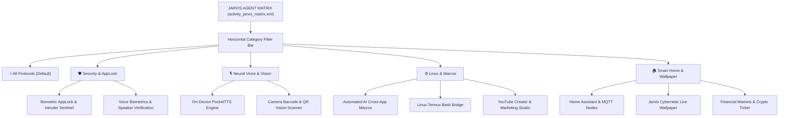

# JARVIS × MYRA AI — JARVIS MATRIX AUTONOMOUS AGENT SPECIFICATION
**Document ID:** `JARVIS-MATRIX-SPEC-006`  
**Classification:** Autonomous Multi-Agent Tactical Execution Engine  
**Target Activity:** `com.jarvis.assistant.ui.matrix.JarvisMatrixActivity` (`activity_jarvis_matrix.xml`)  
**Package:** `com.jarvis.assistant`  

---

## 1. Executive Purpose & Distinct Role of Jarvis Matrix

Jarvis Matrix is the **Tactical Agentic Execution Hub** of the platform. Unlike SuperCore (which governs low-level Android operating system permissions and system services), Jarvis Matrix is dedicated to executing complex, multi-step autonomous workflows across external platforms, developer environments, terminal runtimes, creator suites, and IoT protocols.

```
+-------------------------------------------------------------------------+
|                          JARVIS CORE SYSTEM                             |
+------------------------------------+------------------------------------+
|       SUPERCORE OS CONTROLLER      |        JARVIS MATRIX ENGINE        |
|  (Low-Level Android OS Privileges) |     (Autonomous Agentic Tools)     |
+------------------------------------+------------------------------------+
| - Android Default Assistant Hook   | - Termux Linux Script Execution    |
| - Accessibility Auto-Click Service | - AI App Macro Sequences           |
| - WhatsApp Notification Intercept  | - YouTube Creator Automation       |
| - Driving Vehicle Bluetooth Link   | - Voice Biometrics & AppLock Guard |
| - Battery & Power Governance       | - Home Assistant Smart Home MQTT   |
+------------------------------------+------------------------------------+
```

---

## 2. Matrix Information Architecture & Category Filter System

Jarvis Matrix implements a dynamic categorical chip filtering bar at the top of the viewport (`HorizontalScrollView` with 5 persistent filter chips). Tapping a chip plays cybernetic tap audio (`HudSoundManager.playTapSound()`), updates chip states, and transitions section visibility with hardware-accelerated cross-fades.



---

## 3. Deep Technical Protocol & Agent Inventory

### 3.1 Protocol Suite 1: Security & Autonomous Intruder Defense
- **Biometric AppLock (`secBiometricAppLock`):**
  - Guards confidential apps (WhatsApp, Photos, Banking, Termux) behind biometric fingerprint or PIN challenge.
  - Controls: Target app selector, lock timeout dropdown (Instant, 1m, 5m), bypass on trusted Bluetooth.
- **Voice Biometric Guardian (`secVoiceGuardian`):**
  - Compares incoming speech against enrolled voice vector embeddings (`VoiceEnrollmentActivity.kt`).
  - Unauthorized Speaker Defense: Rejects wake commands from unauthorized voices; triggers silent front-camera intruder photo snapshot (`triggerIntruderPhotoCapture()`) and logs security intrusion alert.

---

### 3.2 Protocol Suite 2: Neural Voice & Computer Vision
- **On-Device PocketTTS Engine (`secPocketTts`):**
  - High-speed zero-cloud text-to-speech synthesis running local ONNX / neural voice models (`PocketTtsEngine.kt`).
  - Features: Pitch, Speed, Energy sliders; voice model selector (`en-US-Jenny`, `en-US-Guy`, `hi-IN-Swara`).
- **Tactical Vision & Barcode Scanner (`secBarcodeScanner`):**
  - Integrated ML Kit camera scanner (`BarcodeScannerEngine.kt`).
  - Instant decoding of QR codes, UPC barcodes, Wi-Fi credentials, and cryptographic URLs with direct action dispatch (e.g., auto-join Wi-Fi network).

---

### 3.3 Protocol Suite 3: Linux Environment & Cross-App Macros
- **Linux Termux Bridge (`secLinuxTermux`):**
  - Direct communication pipeline with the Termux Linux runtime (`TermuxBridge.kt` via `com.termux.RUN_COMMAND`).
  - Capabilities: Execute bash scripts, run local Python scrapers, trigger git commits, check system Docker containers.
  - Interactive Terminal Card: Displays last command executed, exit code, execution time, and stdout/stderr stream.
- **Automated AI Macros (`secAiMacros`):**
  - Multi-app robotic process automation backed by `JarvisAccessibilityService.kt`.
  - Preset Sequences: "Generate Midjourney Art", "Send Scheduled WhatsApp Broadcast", "Extract On-Screen Table to CSV".
- **YouTube Creator Studio & Marketing Agent (`secCreatorStudio`):**
  - Controls: `YouTubeCreatorToolkit.kt`.
  - Capabilities: Analyzes trending video titles, generates SEO tags, drafts thumbnail concept prompts, and monitors channel subscriber telemetry.

---

### 3.4 Protocol Suite 4: Smart Home & Ambient Environment
- **Home Assistant & MQTT Smart Nodes (`secSmartHome`):**
  - Connects to local Home Assistant instance or MQTT broker (`tcp://192.168.x.x:1883`).
  - Tiles: Smart Lights toggle, Climate thermostat slider, Scene trigger ("Stark Lab Mode").
- **Cybernetic Live Wallpaper Service (`secLiveWallpaper`):**
  - `JarvisWallpaperService.kt`: Renders the live interactive WebGL particle orb or Stark holographic grid directly on the Android home screen and lock screen.
- **Financial Markets & Crypto Telemetry (`secStocks`):**
  - Live price tracking cards for S&P 500, NASDAQ, Bitcoin, and Ethereum with percentage change badges and sparkline graphs.

---

## 4. UI Card Architecture & Interaction Design

1. **Card Visual Standard:** Each protocol section is enclosed within an obsidian container (`@drawable/bg_jarvis_action_card`, background `#0E1322`, border `1dp #1A243D`, corner radius `14dp`).
2. **Status Indicators:** Every card displays a right-aligned pill badge indicating its runtime status (`ACTIVE`, `STANDBY`, `UNCONFIGURED`, `OFFLINE`).
3. **Execution Feedback:** When an agent command is launched (e.g. running a Termux script), the button morphs into a circular progress spinner with an embedded textual elapsed time counter. Upon completion, a subtle green flash and haptic pulse notify the operator.

---
*Verified against active Android implementation in `JarvisMatrixActivity.kt`.*
