# JARVIS × MYRA AI — SUPERCORE SYSTEM ARCHITECTURE & UI/UX SPECIFICATION
**Document ID:** `JARVIS-SUPERCORE-SPEC-005`  
**Classification:** OS-Level Controller & System Intelligence Architecture  
**Target Activity:** `com.jarvis.assistant.ui.supercore.SuperCoreActivity` (`activity_super_core.xml`)  
**Package:** `com.jarvis.assistant`  

---

## 1. Executive Mission & Structural Role of SuperCore

SuperCore is the **Operating System Layer Controller** of the Jarvis platform. While typical AI assistants remain confined within sandboxed webviews or single chat activities, SuperCore bridges Jarvis directly into the Android OS kernel and system frameworks.

### Strict Architectural Boundaries: SuperCore vs. Jarvis Matrix
- **SuperCore (System Controller):** Manages Android OS privileges, background listeners, low-level telephony, unread notification pipes, driving vehicle detection, and accessibility UI automation.
- **Jarvis Matrix (Agentic Execution):** Manages high-level autonomous multi-agent reasoning, Termux Linux scripting, n8n webhook pipelines, code generation, and social media dispatchers.

---

## 2. SuperCore User Interface & Visual Hierarchy

SuperCore utilizes an industrial cybernetic dashboard with modular hardware-styled telemetry cards:

```mermaid
graph TD
    SuperCore["SUPERCORE OS CONTROLLER (activity_super_core.xml)"]
    
    SuperCore --> Card1["Card 1: Android Default Digital Assistant"]
    Card1 --> ActAssist["Set as Assistant Action"]
    Card1 --> SwitchGround["Screen & Web Intelligence Switch"]
    
    SuperCore --> Card2["Card 2: WhatsApp & Messaging Auto-Reader"]
    Card2 --> ActNotif["Grant Notification Access Action"]
    Card2 --> SwitchWA["WhatsApp / Business Switch"]
    Card2 --> SwitchTG["Telegram & Signal Switch"]
    Card2 --> SwitchVoiceReply["Voice Auto-Reply Confirmation Switch"]

    SuperCore --> Card3["Card 3: Driving Mode & Call Sentinel"]
    Card3 --> SwitchBT["Auto-Activate on Car Bluetooth"]
    Card3 --> SwitchCallerID["Voice Caller ID Announcement"]
    Card3 --> AutoAnswer["Hands-Free Voice Answer/Decline"]

    SuperCore --> Card4["Card 4: Hardware Sensors & Battery Sentinel"]
    Card4 --> SwitchBattery["Battery Optimization Exemption"]
    Card4 --> LiveThermal["CPU Temperature & Governor Monitor"]
    Card4 --> RAMGauge["Active RAM Telemetry Gauge"]
```



---

## 3. Detailed Card-by-Card Technical Specification

### 3.1 Card 1: Default Android Digital Assistant Binding
- **Visual Style:** Obsidian card with primary cyan accent (`#00E5FF`), live status pill badge (`tvDefaultAssistantBadge`).
- **Real-Time Detection Logic:**
  ```kotlin
  val defaultAssistant = Settings.Secure.getString(contentResolver, "voice_interaction_service")
  val isJarvisDefault = defaultAssistant?.contains(packageName) == true
  ```
- **Status Badge States:**
  - `ACTIVE` (Tactical Green `#00E676`): Jarvis is currently bound as Android default assistant.
  - `DISABLED` (Stark Amber `#FF9100`): Google Assistant or device default is active.
- **Action Trigger (`btnSetDefaultAssistant`):**
  - Dispatches `Intent(Settings.ACTION_VOICE_INPUT_SETTINGS)` to let the user select Jarvis with zero confusion.
- **Feature Switch (`switchScreenIntelligence`):**
  - Toggles `UiGroundingEngine.kt` to extract on-screen accessibility node hierarchies (`AccessibilityNodeInfo`) and feed text contexts to the active LLM session.

---

### 3.2 Card 2: Smart WhatsApp & Messaging Auto-Reader
- **Visual Style:** Obsidian card with emerald communication accent (`#10B981`), notification listener status pill (`tvNotificationListenerBadge`).
- **System Hook:** Intercepts notifications via `JarvisNotificationListener.kt`.
- **Subsystem Controls:**
  - `switchWhatsAppReader`: Filters `com.whatsapp` and `com.whatsapp.w4b` package notifications.
  - `switchTelegramReader`: Filters `org.telegram.messenger` and `org.thoughtcrime.securesms` (Signal).
  - `switchAutoReplyConfirm`: When true, assistant announces: *"Incoming message from Alex: 'Are you available?' — Say 'Reply' to dictate or 'Ignore'"*. When false, automatically drafts contextual replies in standby mode.
- **Direct Action Button (`btnGrantNotificationAccess`):**
  - Dispatches `Intent(Settings.ACTION_NOTIFICATION_LISTENER_SETTINGS)` with deep link to Jarvis listener service.

---

### 3.3 Card 3: Driving Mode & Call Sentinel
- **Visual Style:** Obsidian card with high-visibility amber accent (`#F59E0B`), driving mode status pill (`tvDrivingModeBadge`).
- **Telemetry Sensors:**
  - Registered to `BluetoothDevice.ACTION_ACL_CONNECTED` and `BluetoothHeadset.ACTION_CONNECTION_STATE_CHANGED`.
  - Filters vehicle Bluetooth profiles (`BluetoothClass.Device.Major.AUDIO_VIDEO` with car carkit minor class).
- **Subsystem Controls:**
  - `switchAutoCarAudio`: Automatically boots high-volume hands-free mode upon vehicle pairing.
  - `switchCallerIdAnnouncement`: Ingests `TelephonyManager.ACTION_PHONE_STATE_CHANGED`, queries `ContactsContract` for caller name, and speaks caller ID aloud through vehicle audio stream (`AudioManager.STREAM_VOICE_CALL`).
  - Voice Commands: Listens for *"Answer"* (`TelecomManager.acceptRingingCall()`) or *"Decline"* (`TelecomManager.endCall()`).

---

### 3.4 Card 4: Local Host AI & Neural Memory
- **Visual Style:** Obsidian card with neon violet accent (`?attr/themeAccent`), local host heartbeat badge.
- **Host Endpoint Monitored:** `http://192.168.x.x:11434/api/tags` or `http://10.0.2.2:11434`.
- **Subsystem Controls:**
  - `btnTestLocalHost`: Dispatches non-blocking HTTP GET ping to local Ollama server, measuring round-trip latency in milliseconds.
  - `switchLocalOnlyMode`: Disables all cloud Gemini API calls, routing 100% of reasoning to local Qwen 2.5 / Llama 3 models for zero-data-leakage privacy.
  - `tvMemoryCount`: Displays live count of vector embeddings stored in local Room database (`com.jarvis.assistant.data.memory.MemoryEntity`).

---

## 4. UI/UX Interaction & State Feedback Standards

1. **Reactive Badge Updates:** Whenever the operator returns from Android Settings (via `onResume()`), all 4 badges re-evaluate instantly within `<50ms` and smoothly animate from Amber to Green without requiring a manual refresh button.
2. **Error Recovery & Guidance:** If a required permission is revoked by Android OS battery managers, the card border pulses subtly in amber and a direct resolution button appears in place of the switch.
3. **Back-Stack Ergonomics:** Top back button (`btnBack`) performs standard `onBackPressedDispatcher.onBackPressed()` with a smooth exit slide to `MainActivity`.

---
*Verified against active Android implementation in `SuperCoreActivity.kt`.*
