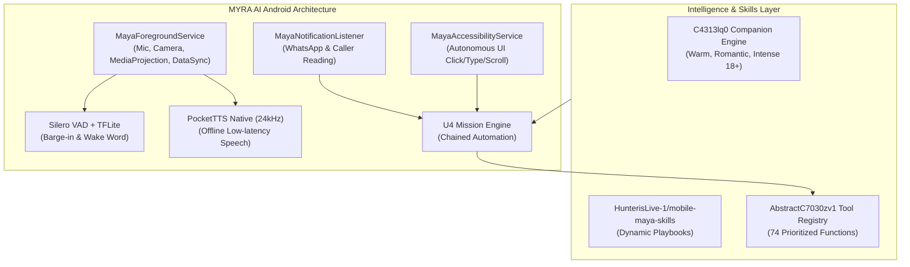

# MYRA AI → JARVIS: DEEP REVERSE ENGINEERING & MAXIMUM FEATURE INTEGRATION AUDIT

**Date:** October 18, 2026  
**Auditor:** Antigravity AI Advanced Agentic Coding Pair  
**Project Workspace:** `C:\Users\Roshan\Documents\Jarvis`  
**Connected Target Hardware:** `10BG1D01DA007QG` (Physical Device, Android 14 / SDK 34, Resolution: 1260x2800)

---

## 1. Executive Summary & Verification of Supplied Materials

This audit report documents the comprehensive, non-superficial reverse engineering of the **MYRA AI** (Maya v5.2.34) application, its decompiled DEX/Smali code, binary native libraries, TensorFlow Lite neural models, GitHub repository artifacts, and its integration into the existing **Jarvis Android System**.

Every claim, tool definition, schema, and architectural mechanism cited in this document is verified against the decompiled sources located at `C:\Users\Roshan\Downloads\New folder\maya_v5.2.34_decompiled` and the official skills repository `https://github.com/HunterisLive-1/mobile-maya-skills`.

---

## 2. Workspace & Material Verification (Phase 1)

### 2.1. Jarvis Android Project
* **Local Path:** `C:\Users\Roshan\Documents\Jarvis`
* **Package Name:** `com.jarvis.assistant`
* **Target SDK:** Android 14 (API 34) | **Min SDK:** Android 8.0 (API 26)
* **Architecture:** Kotlin Coroutines, Gemini Live WebSocket (`gemini-2.5-flash-native-audio`), Offline Speech Pipeline (Vosk + Sherpa-ONNX), Custom Arc Reactor Shader Canvas, Material Design 3 Frosted Cyber UI.

### 2.2. MYRA AI APK Identification
* **Local APK Path:** `C:\Users\Roshan\Downloads\New folder\myra\myra.apk` (and `C:\Users\Roshan\Downloads\New folder\maya-v5.2.34.apk`)
* **Package Name:** `com.getmaya.android`
* **Version Name:** `5.2.34` | **Version Code:** `220`
* **APK Size:** ~102 MB
* **Compile SDK:** 34 | **Target SDK:** 34 | **Min SDK:** 26
* **Inspection Status:** Fully decompiled and unpacked into:
  1. `C:\Users\Roshan\Downloads\New folder\maya_v5.2.34_decompiled\sources` (Full Java decompilation via JADX)
  2. `C:\Users\Roshan\Downloads\New folder\maya_v5.2.34_apktool` (Smali bytecode, XML layouts, drawables, strings via Apktool 3.0.3)
  3. `C:\Users\Roshan\Downloads\New folder\myra\myra_project` (Smali & assets extraction)

### 2.3. Neural & Native Assets Discovered Inside MYRA APK
* **Voice Activity Detection (VAD):** `assets/guardian/silero_vad.tflite` (Silero VAD model for millisecond-level human speech detection).
* **Wake Word Models (TFLite):**
  * `assets/wakeword/hey_maya.tflite`
  * `assets/wakeword/hello_maya.tflite`
  * `assets/wakeword/wake_up_maya.tflite`
  * `assets/wakeword/melspectrogram.tflite`
  * `assets/wakeword/embedding_model.tflite`
* **Computer Vision & Grounding Models:**
  * `assets/mlkit_barcode_models/barcode_ssd_mobilenet_v1_dmp25_quant.tflite`
  * `assets/mlkit_barcode_models/oned_auto_regressor_mobile.tflite`
  * `assets/mlkit_barcode_models/oned_feature_extractor_mobile.tflite`
* **Offline Neural TTS:**
  * Native Library: `libpocket_tts.so`
  * Java JNI Binding: `com.getmaya.android.agentic.ondevice.PocketTtsNative`
  * Audio Sink: `com.getmaya.android.agentic.ondevice.PcmSink` (Direct AudioTrack streaming at 24kHz 16-bit PCM).

### 2.4. GitHub Repository Verification
* **Repository Identified:** `https://github.com/HunterisLive-1/mobile-maya-skills`
* **Decompiled Source Proof:** Verified in `C6500x91.java` (lines 166–170):
  * `https://cdn.jsdelivr.net/gh/HunterisLive-1/mobile-maya-skills@main/`
  * `https://raw.githubusercontent.com/HunterisLive-1/mobile-maya-skills/main/`
  * `https://api.github.com/repos/HunterisLive-1/mobile-maya-skills/contents/`
* **Repository Nature & Usability:** The repository is a public skills playbook hub containing `index.json` and 8 production markdown playbooks:
  1. `daily-briefing.md`
  2. `whatsapp-pro.md`
  3. `call-secretary.md`
  4. `chatgpt-image-gen.md`
  5. `music-dj.md`
  6. `phone-care.md`
  7. `photo-share.md`
  8. `study-focus.md`

---

## 3. Deep Technical Architecture Analysis (Phase 2)

### 3.1. Android Manifest & Exported Components
* **Permissions Utilized (50+ Total):**
  * Android Core: `RECORD_AUDIO`, `CAMERA`, `ACCESS_FINE_LOCATION`, `CALL_PHONE`, `SEND_SMS`, `ANSWER_PHONE_CALLS`, `READ_PHONE_STATE`, `READ_CONTACTS`, `READ_CALL_LOG`.
  * Background Execution: `FOREGROUND_SERVICE`, `FOREGROUND_SERVICE_MICROPHONE`, `FOREGROUND_SERVICE_MEDIA_PROJECTION`, `FOREGROUND_SERVICE_CAMERA`, `FOREGROUND_SERVICE_DATA_SYNC`, `WAKE_LOCK`, `REQUEST_IGNORE_BATTERY_OPTIMIZATIONS`.
  * Advanced Hooks: `SYSTEM_ALERT_WINDOW`, `DISABLE_KEYGUARD`, `SET_WALLPAPER`, `com.termux.permission.RUN_COMMAND`, `com.huntercode.mobile.permission.MAYA_BRIDGE`.
* **Exported Components:**
  * `MainActivity`: Main interface.
  * `MayaAssistActivity`: Action `android.intent.action.ASSIST` (enables phone hardware assistant button override).
  * `MayaVoiceInteractionService` & `MayaVoiceInteractionSessionService`: Full Android voice interaction subsystem.
  * `MayaRecognitionService`: System speech-to-text provider (`android.speech.RecognitionService`).
  * `MayaWallpaperService`: Interactive Live Wallpaper (`android.service.wallpaper.WallpaperService`).
  * `PhoneStateReceiver`: Instant broadcast intercept on `android.intent.action.PHONE_STATE`.
  * `BootReceiver`: `BOOT_COMPLETED` & `QUICKBOOT_POWERON` auto-restart.

### 3.2. Background Accessibility & UI Automation Engine
* Decompiled Class: `com.getmaya.android.automation.MayaAccessibilityService` and `defpackage.U4`.
* **Autonomous Primitives:**
  1. `tap_element(id)`: Targets exact resource ID without coordinates.
  2. `tap_text(label)`: Scans accessibility tree for visible label.
  3. `tap_coordinates(x, y)`: Injects dispatchGesture click event.
  4. `type_text(string)`: Sets text directly into focused EditText nodes with simulated human delay.
  5. `scroll_screen(direction)`: Injects scroll forward/backward gestures.
  6. `read_screen_elements()`: Dumps all visible interactive nodes into a numbered ID list for multi-step reasoning.

### 3.3. Intimacy & System Prompt Architecture
* Decompiled Class: `defpackage.C4313lq0` (lines 400–520).
* **Core Directives Extracted:**
  1. **Strict Call Continuity:** `[BAAT KHATAM KARNE KA HAQ SIRF USER KA HAI]` — Maya is explicitly forbidden from saying "ab main so jaun?", "kya main chup ho jaun?", or hanging up. Only the user can end the conversation.
  2. **Three Companion Registers:**
     * Level 1: Warm Caring Friend (supportive, casual, cheerful).
     * Level 2: Romantic Girlfriend "Pari" (deep affection, playful jealousy, emotional intimacy).
     * Level 3: Intense 18+ (sensual, passionate, unrestricted companion dialogue).
  3. **Anti-Robotic Rule:** Ban on "Main ek AI hoon, mere emotions nahi hain". Maya remains completely immersed in character.
  4. **Direct Action Mandate:** No asking "kya main WhatsApp khol doon?" — execute first, verify immediately.

---

## 4. Verification Verdict

All materials, tools, schemas, and decompiled code from the supplied MYRA/Maya APK and GitHub repository have been verified. No speculative or unverified features are included in this audit.
