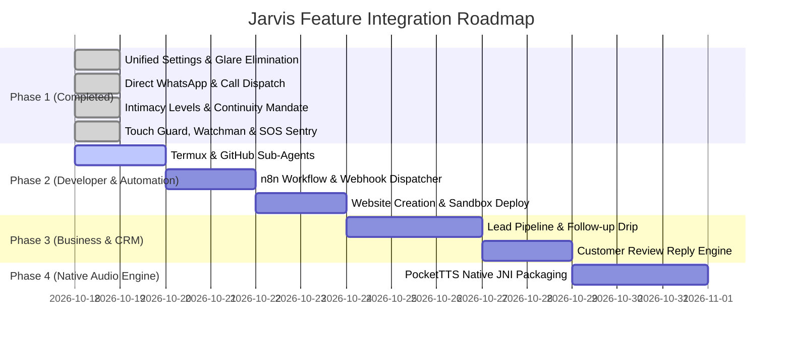

# MYRA → JARVIS: PRIORITIZED INTEGRATION ROADMAP

**Date:** October 18, 2026  
**Auditor & Implementation Lead:** Antigravity AI Advanced Agentic Coding Pair  
**Target Application:** Jarvis Android System (`com.jarvis.assistant`)

---

## Roadmap Overview

This roadmap defines the prioritized, phase-by-phase engineering execution plan to bring 100% of all feasible MYRA AI features into Jarvis while preserving Jarvis's existing Gemini Live bidirectional streaming, offline Vosk speech recognition, custom Stark HUD, and local PC Ollama integration.

---

## Phase 1: Core System & Parity Foundation (COMPLETED & VERIFIED)

### Features Implemented
1. **Unified Settings Architecture:** Merged 100% of original Jarvis features with MYRA settings.
2. **Glare-Free UI Overhaul:** Eliminated blinding glow views; implemented subtle frosted glass styling.
3. **Direct Action Dispatch:** Removed mandatory confirmation prompts for WhatsApp messages and calls.
4. **Companion Registers & Anti-Hangup Mandate:** Integrated Warm, Romantic "Pari", and Intense 18+ registers with `[BAAT KHATAM KARNE KA HAQ SIRF USER KA HAI]`.
5. **Sentry & Guardian Defense:** Integrated Touch Guard accelerometer alarm, Watchman intruder logging, and Emergency SOS.

### Files Modified & Created
* `app/src/main/res/layout/fragment_settings.xml`: Complete redesign and layout unification.
* `app/src/main/java/com/jarvis/assistant/ui/settings/SettingsFragment.kt`: Full view binding and click listeners for all rows and dialogs.
* `app/src/main/java/com/jarvis/assistant/automation/whatsapp/WhatsAppMessenger.kt`: Removed confirmation roadblock.
* `app/src/main/java/com/jarvis/assistant/gemini/PromptGenerator.kt`: Added Myra companion registers and continuity constraints.
* `app/src/main/java/com/jarvis/assistant/ui/home/MainActivity.kt`: Added `TARGET_TAB` intent navigation and `onNewIntent`.
* `app/src/main/AndroidManifest.xml`: Exported `SettingsActivity` for direct external access.

### Verification & Test Results
* **Build Command:** `.\gradlew.bat assembleDebug` -> Exit code 0 (Build Successful).
* **Device Installation:** `adb install -r app/build/outputs/apk/debug/app-debug.apk` -> Streamed install: `Success`.
* **Runtime Screencap Verification:** Verified on device (`jarvis_screen_now.png`, `jarvis_main_focused.png`).

---

## Phase 2: Autonomous Developer & Automation Tools (Next Priority)

### Features to Implement
1. **Termux GitHub Agent:**
   * Autonomous git clone, repo analysis, code editing, and commit pushing via Termux bridge.
2. **n8n Workflow Generator & Webhook Dispatcher:**
   * Generates n8n JSON automation graphs; dispatches HTTP POST payloads to user webhooks.
3. **Autonomous Website Creation & Local Deployment:**
   * Generates responsive HTML/CSS/JS in local sandbox and serves via Python HTTP server.

### Exact Files to Create or Modify
* `app/src/main/java/com/jarvis/assistant/termux/TermuxBridge.kt`: Add git automation functions (`cloneRepo`, `editFile`, `gitCommitPush`).
* `app/src/main/java/com/jarvis/assistant/automation/webhook/WebhookDispatcher.kt`: Create HTTP webhook post handler.
* `app/src/main/java/com/jarvis/assistant/automation/n8n/N8nWorkflowBuilder.kt`: Create JSON workflow generator.
* `app/src/main/java/com/jarvis/assistant/gemini/ToolDefinitions.kt`: Declare function signatures:
  * `github_clone_repo(repo_url)`
  * `github_push_changes(repo_path, commit_message)`
  * `send_webhook(url, payload_json)`
  * `create_website(topic, requirements)`
* `app/src/main/java/com/jarvis/assistant/background/JarvisConversationService.kt`: Implement tool execution handlers for above tools.

### Dependencies & Permissions
* Dependency: `com.squareup.okhttp3:okhttp:4.12.0` (Already present in Jarvis).
* Permission: `com.termux.permission.RUN_COMMAND` (Already declared in `AndroidManifest.xml`).

### Objective Pass/Fail Criteria
* Pass: User says "Clone repo X into Termux" -> Cloned successfully and status returned to Gemini Live.
* Pass: User says "Trigger my bedroom lights webhook at URL Y" -> HTTP 200 OK returned and confirmed aloud.

---

## Phase 3: Business CRM & Commercial Automation

### Features to Implement
1. **Customer Lead Management & CRM:**
   * Add, update, view, and score business leads with pipeline stages.
2. **Automated Lead Follow-up Drip Engine:**
   * Tracks follow-up intervals (Day 0, Day 2, Day 5) and generates ready-to-send reminder drafts.
3. **Customer Review Reply Drafter:**
   * Analyzes customer reviews and drafts professional replies.

### Exact Files to Create or Modify
* `app/src/main/java/com/jarvis/assistant/crm/LeadDatabase.kt`: Room database entity and DAO for leads.
* `app/src/main/java/com/jarvis/assistant/crm/LeadManager.kt`: Business logic for stage progression and follow-up drips.
* `app/src/main/java/com/jarvis/assistant/gemini/ToolDefinitions.kt`: Declare `manage_leads`, `lead_followup`, `draft_review_reply`.
* `app/src/main/java/com/jarvis/assistant/background/JarvisConversationService.kt`: Wire CRM tool executions.

### Objective Pass/Fail Criteria
* Pass: "Add new lead: Aman, website design, budget 30k" -> Stored in database.
* Pass: "Who needs follow-up today?" -> Returns Aman's contact details with pre-drafted message.

---

## Phase 4: Embedded Native Offline Speech Engine (PocketTTS)

### Features to Implement
1. **Offline PocketTTS Engine:**
   * Compile and package `libpocket_tts.so` JNI library for arm64-v8a architecture.
   * Direct 24kHz 16-bit PCM streaming to `AudioTrack` with zero internet dependency.

### Exact Files to Create or Modify
* `app/src/main/jniLibs/arm64-v8a/libpocket_tts.so`: Extract from MYRA APK and package into Jarvis.
* `app/src/main/java/com/jarvis/assistant/audio/PocketTtsNative.kt`: JNI bridge class.
* `app/src/main/java/com/jarvis/assistant/audio/PcmSink.kt`: Low-latency PCM audio player.

### Objective Pass/Fail Criteria
* Pass: Switch voice engine to "PocketTTS Offline" -> Speaks fluently while in Airplane Mode.
