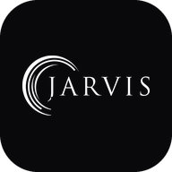

# ⚡ JARVIS — Autonomous AI Assistant & Cybernetic Mobile OS

<div align="center">



### **The Definitive Cybernetic Operating Assistant for Android**
*Inspired by Tony Stark's J.A.R.V.I.S. — Built with Edge AI, Global Geospatial Intelligence & Deep OS Automation.*

[-00E5FF?style=for-the-badge&logo=android&logoColor=white)](https://android.com)
[](https://kotlinlang.org)
[](https://github.com/allproject121/Jarvis/actions/workflows/build-apk.yml)
[](https://github.com/allproject121/Jarvis/releases/latest)
[](LICENSE)
[](https://github.com/tiwariroshan121)

---

### 📲 [Download Latest Jarvis APK Releases](https://github.com/allproject121/Jarvis/releases)
**Direct Download:** [**Latest Release APK**](https://github.com/allproject121/Jarvis/releases/latest) • **Beta Package:** [`package/Jarvis-Beta-Version.apk`](package/Jarvis-Beta-Version.apk)  
*Pre-compiled Android APK with 3D Arc Reactor, God's Eye Reconnaissance, and offline neural engine.*

</div>

---

## ⚡ Quick Start (Phone Install)

1. **Download:** Tap [**Latest Release APK**](https://github.com/allproject121/Jarvis/releases/latest) on your Android device.
2. **Install:** Open the downloaded `.apk` and allow installation from your browser/file manager.
3. **Grant Core Permissions:**
   - 🎤 **Microphone:** For continuous voice recognition & Gemini Live conversation.
   - 🪟 **Display over other apps:** For floating 3D companion HUD.
   - ♿ **Accessibility Service:** For autonomous screen navigation, human-like typing & WhatsApp automation.

---

## 🏛️ System Architecture

JARVIS runs on a resilient **Dual-Brain Architecture** connecting high-throughput multimodal cloud intelligence with a **100% offline edge AI runtime**:

```
+-------------------------------------------------------------------------+
|                  HOLOGRAPHIC 3D & FLOATING COMPANION                    |
|       Three.js WebGL • 3D Arc Reactor • Mora VRM • System-Wide HUD      |
+-------------------------------------------------------------------------+
                                    ▲
                                    │
+-------------------------------------------------------------------------+
|                  GOD'S EYE VIEW GEOSPATIAL INTELLIGENCE                 |
|       Cesium 3D Globe • Live CCTV • Flights • Satellites • Wildfires    |
+-------------------------------------------------------------------------+
                                    ▲
                                    │
+-------------------------------------------------------------------------+
|                       DUAL-BRAIN AI CORE & ROUTER                       |
|   Online: Gemini Live (WebSocket) / GPT-4o                              |
|   Offline: LLaMA on-device SLM • Vosk Voice Pipeline • Vector RAG       |
|   Failover: Auto-switches offline if disconnected, restores in 5s       |
+-------------------------------------------------------------------------+
                                    ▲
                                    │
+-------------------------------------------------------------------------+
|                 JARVIS SUPERCORE & DEVICE AUTOMATION                    |
|   Accessibility Engine • WhatsApp Auto-Dispatch • Guardian Security     |
+-------------------------------------------------------------------------+
```

---

## 🌟 Key Capabilities

### 🧠 1. Dual-Brain AI & Voice Pipeline
- **Cloud Intelligence:** Persistent bidirectional audio streaming via Google Gemini Live & OpenAI GPT-4o with real-time tool dispatch.
- **100% Offline Edge Brain:** Local quantized models (Gemma 2, Qwen 2.5, Llama 3.2) via embedded `llama.cpp` runtime with zero internet needed.
- **Continuous Voice Loop:** Vosk on-device wake-word detection, speaker verification, and low-latency speech synthesis.

### 🛰️ 2. God's Eye View (Geospatial Reconnaissance)
- **3D Cesium Globe:** Photorealistic planetary rendering with terrain and satellite imagery.
- **Live Telemetry:** Real-time AISStream maritime vessels, OpenSky flights, FIRMS wildfire thermal hotspots, USGS earthquakes, and 3,700+ CCTV camera streams.

### 🎭 3. Holographic 3D Companions & Studio
- **Dynamic 3D Visualizer:** Audio-reactive 3D Arc Reactor, Quantum Orb, and customizable VRM companion characters (Mora / J.E.T.T.).
- **Floating HUD:** System-wide overlay companion dockable to screen edges with minimal battery footprint.

### 📱 4. Jarvis SuperCore OS Automation
- **Autonomous Navigation:** Deep Android accessibility automation for hands-free typing, app launching, and system settings control.
- **Smart Messaging:** Automated hands-free WhatsApp and messaging workflows.

### 🛡️ 5. Guardian Security & Anti-Theft Sentry
- **Touch Guard & Intruder Capture:** Motion sensors trigger alarms and capture camera snapshots on unauthorized handling.
- **Hardware-Backed Security:** API credentials encrypted via Android Keystore (AES-256 GCM).

---

## 🛠️ Build & Development

### Method 1: Cloud Build (GitHub Actions)
Every push to `main` automatically compiles, verifies, and packages the debug APK via GitHub Actions. Download the latest builds directly from [GitHub Actions Artifacts](https://github.com/allproject121/Jarvis/actions/workflows/build-apk.yml) or [GitHub Releases](https://github.com/allproject121/Jarvis/releases).

### Method 2: Local Compilation
- **Requirements:** JDK 17, Android Studio 2024.1+, Android SDK (API 28–35).

```bash
# Clone the repository
git clone https://github.com/allproject121/Jarvis.git
cd Jarvis

# Build Debug APK
./gradlew :app:assembleDebug
```
The output APK is generated at `app/build/outputs/apk/debug/app-debug.apk`.

---

## ⚙️ App Configuration

1. Launch JARVIS on Android.
2. Open **Settings (⚙️) > Neural Brain & Connections**.
3. Add your keys:
   - **Gemini API Key:** From [Google AI Studio](https://aistudio.google.com/) (for cloud voice streaming).
   - **Cesium Ion Token (Optional):** For 3D photorealistic globe tiles in God's Eye.

---

## 👨‍💻 Author & Attribution

- **Lead Architect:** **Roshan Tiwari**
- **GitHub:** [@tiwariroshan121](https://github.com/tiwariroshan121)
- **Email:** [tiwariroshan2601@gmail.com](mailto:tiwariroshan2601@gmail.com)
- **Repository:** [allproject121/Jarvis](https://github.com/allproject121/Jarvis)
- **License:** [Roshan TAMCL v1.0](LICENSE)

<div align="center">

*“Sometimes you gotta run before you can walk.” — Tony Stark*

</div>
