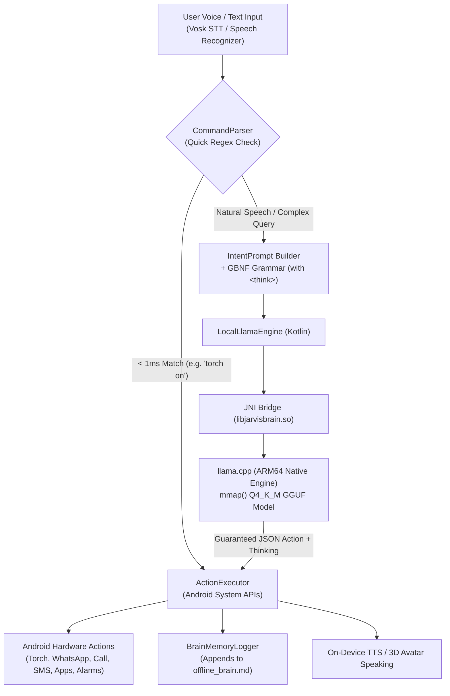

# 🧠 JARVIS OFFLINE ON-DEVICE AUTONOMOUS BRAIN
> **100% Offline | Zero Cloud API | No Desktop App Required | Sovereign & Uncensored**

---

## 1. System Architecture — How It Works

Traditional assistants rely on external cloud APIs (like OpenAI, Claude, Gemini) or local desktop servers (like Ollama running on a PC). Jarvis runs **100% on the Android device's own CPU/RAM** using compiled C++ machine learning runtimes (`llama.cpp` through Android NDK).



### Key Working Principles:
1. **Memory-Mapped Weight Loading (`mmap`)**:
   - The `.gguf` quantized model is stored in `context.filesDir/models/`.
   - Instead of reading 1.2 GB of data into Java heap memory (which causes Out-Of-Memory crashes), Linux kernel virtual memory `mmap()` is used. Only the active model layers currently being executed are paged into physical RAM.
2. **ARM64 Hardware Acceleration**:
   - Compiled with `-march=armv8.2-a+dotprod+fp16` and `-O3` optimizations.
   - Uses CPU NEON vector instructions and 8-bit dot product hardware instructions present on Snapdragon 7xx/8xx and MediaTek Dimensity chips, achieving ~15-30 tokens/second on mobile CPUs.
3. **GBNF Grammar-Constrained Decoding + `<think>` Chain-of-Thought**:
   - Small models (1.5B) normally hallucinate or print conversational fluff.
   - We pass a **GBNF grammar** to the llama.cpp sampler. The sampler forces the logits at every token step to only match valid JSON structure (`{"action": "...", "params": {...}}`), while allowing DeepSeek-R1 style `<think>` reasoning tags for autonomous planning.
   - Refusal text, apologies, and corporate lecture phrases are mathematically masked out at the token sampling level!

---

## 2. API & Connection Controls (Master ON/OFF Switches)

In **Settings -> API & Connection**, Jarvis now provides **3 Master Power Switches**:

| Engine | Switch ID | Description | What happens when toggled OFF |
|---|---|---|---|
| **Google Gemini API (Cloud)** | `switchGeminiEnabled` | Real-time cloud audio/text | Completely cuts off Gemini. All queries route to On-Device Brain. Zero cloud packets. |
| **PC Ollama (Local Host LAN/USB)** | `switchOllamaEnabled` | 127.0.0.1:11434 USB Reverse / Wi-Fi | Stops polling PC Ollama server. |
| **100% On-Device Jarvis Brain** | `switchLocalBrainEnabled` | Native ARM64 llama.cpp | Master toggle for the local GGUF engine. |

### How to Force 100% Sovereign Offline Mode:
1. Open Jarvis Settings -> **API & connection**.
2. Turn **Google Gemini API** switch to **OFF**.
3. Turn **PC Ollama** switch to **OFF** (optional).
4. Turn **100% On-Device Jarvis Brain** switch to **ON**.
5. Select **100% On-Device Local Brain** under Preferred AI Provider.

Now Jarvis will **never attempt to connect to Google Cloud**. Everything is processed inside your phone.

---

## 3. Recommended Open-Source GGUF Models

To achieve zero refusals and maximum reasoning speed on Android hardware, use 1.5B–3B parameter models quantized to **Q4_K_M**:

| Model Name | Size (RAM) | Speed on Phone | Strengths | HuggingFace Link |
|---|---|---|---|---|
| **DeepSeek-R1-Distill-Qwen-1.5B (Abliterated)** | ~1.1 GB | ~20-25 tok/s | Full `<think>` Chain-of-Thought, uncensored, great logic | [Download GGUF](https://huggingface.co/huihui-ai/DeepSeek-R1-Distill-Qwen-1.5B-Abliterated-GGUF) |
| **Qwen 2.5 Coder 1.5B Instruct** | ~1.1 GB | ~22-28 tok/s | Structured JSON formatting, precise parameters, zero refusals | [Download GGUF](https://huggingface.co/mradermacher/Qwen2.5-Coder-1.5B-Instruct-GGUF) |
| **SmolLM2 1.7B Instruct** | ~1.0 GB | ~25 tok/s | Ultra lightweight, fast startup | [Download GGUF](https://huggingface.co/HuggingFaceTB/SmolLM2-1.7B-Instruct-GGUF) |

### How to Install a Model into Jarvis:
Option A (Via ADB from PC):
```bash
adb push DeepSeek-R1-Distill-Qwen-1.5B-Abliterated-Q4_K_M.gguf /sdcard/Download/qwen2.5-1.5b-instruct-q4_k_m.gguf
adb shell run-as com.jarvis.assistant cp /sdcard/Download/qwen2.5-1.5b-instruct-q4_k_m.gguf /data/data/com.jarvis.assistant/files/models/qwen2.5-1.5b-instruct-q4_k_m.gguf
```

Option B (Directly on Phone):
Download any `.gguf` file in phone browser, open Jarvis Settings -> API & Connection -> On-Device Brain, and tap **"Load Model File"**.

---

## 4. Autonomous Thinking & Tool Execution

### Supported System Actions in On-Device Brain:
- `whatsapp_send`: Direct WhatsApp messaging via intent and contact resolver.
- `open_app`: Fuzzy matching to launch installed applications.
- `call`: Direct telecom calling.
- `sms`: Send SMS to contacts.
- `flashlight`: Android CameraManager hardware torch.
- `volume`: AudioManager media volume (0-100%).
- `set_alarm` / `set_timer`: Native AlarmClock intent.
- `media`: Play/Pause/Next/Previous media keys.
- `device_info`: Battery percentage, model, OS version.
- `note`: Appends notes to `filesDir/notes.txt`.
- `answer`: Uncensored direct explanation, code generation, or conversational response.

### Deep Thinking (`<think>`):
DeepSeek-R1-Distill and Qwen models will think through prerequisites inside `<think> ... </think>` before dispatching the final action.

---

## 5. Automatic Markdown Conversation Logging (`BrainMemoryLogger.kt`)

Every interaction is permanently saved to **Markdown file (`offline_brain.md`)**:
- **Internal Storage**: `/data/user/0/com.jarvis.assistant/files/offline_brain.md`
- **Public Storage**: `/sdcard/Documents/Jarvis/offline_brain.md`

### Markdown Entry Format:
```markdown
### 🗓️ [2026-11-06 20:30:15] Interaction
- **Mode**: `🧠 Local LLM Inference (380ms)`
- **User Input**: "Rahul ko whatsapp par message karo ki main nikal gaya"
- **Autonomous Thinking Process (`<think>`)**:
  > 1. Target contact: Rahul
  > 2. Action: whatsapp_send
  > 3. Message payload: "main nikal gaya"
- **Raw LLM JSON Output**:
  ```json
  {"action":"whatsapp_send","params":{"contact":"Rahul","message":"main nikal gaya"}}
  ```
- **Decided Action**: `whatsapp_send`
- **Parameters**: `{contact=Rahul, message=main nikal gaya}`
- **Execution Result**: `Opening WhatsApp for Rahul`

---
```

You can view this file in real-time using Obsidian, Markor, or any file viewer.

---

## 6. Agent Work Protocol & Step Tracking Rules (Claude Standard)

Whenever continuing or performing development on this project, all AI agents follow these mandatory rules:
1. **Numbered Decimal Steps & Timestamps**:
   - Every task is tagged with an incremental step number (e.g. `[Step 3.43]`, `[Step 3.44]`, `[Step 3.45]`) and timestamp (`[YYYY-MM-DD HH:mm:ss]`).
   - Recorded in `claude.work` and `WORK_LOG.md` in the project root.
   - Any agent resuming work inspects `claude.work` and immediately continues from the latest step pointer.
2. **Mandatory Code Integrity Check**:
   - When reading or editing any file, verify complete syntax, balanced brackets, proper imports, and defensive error handling before moving to the next task.
   - Never introduce unverified or broken snippets.
